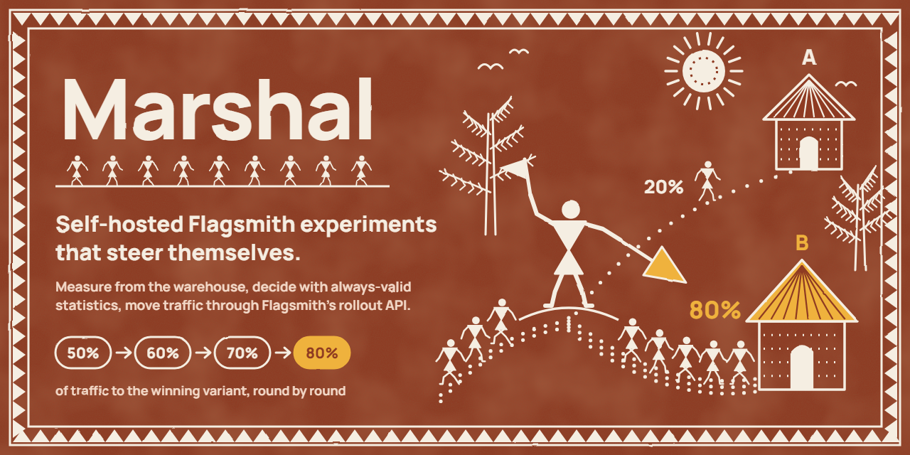

# Marshal

Adaptive traffic allocation for **self-hosted Flagsmith Experimentation**. Marshal watches a running experiment,
decides with statistics that stay valid however often you look, and moves traffic toward the better variant through
Flagsmith's own `PATCH .../experiments/{id}/rollout/` endpoint. Nothing in Flagsmith is patched or forked.

Built for Toggle Wars, Track 03.

## For judges (Track 03: Build on Open Source Flagsmith)

**One sentence:** Marshal makes a self-hosted Flagsmith experiment steer itself: it measures the experiment from the warehouse, decides with statistics that stay valid however often you look, and moves traffic toward the better variant through Flagsmith's own rollout API.

**Two minutes, nothing to install** (Python 3.12):

```
python -m marshal_ab serve --replay docs/replay.json    # the dashboard on a recorded real run, http://localhost:8765
python -m marshal_ab bench --runs 100                    # simulated experiments: Marshal vs a fixed split read two ways (about a minute)
```

The replay needs no Marshal and no Flagsmith: any static host can serve `docs/` (`python -m http.server --directory docs`), and `docs/index.html` falls back to `replay.json`.

**The track's four bullets**

| Bullet | Where it shows |
|---|---|
| Self-hosted Flagsmith | Built and run on self-hosted 2.295.2 with `EXPERIMENTATION_ENABLED`, using the "Flagsmith database" warehouse, so no ClickHouse or Kafka. `sandbox/compose.yml` brings it up. |
| Integrations and plugins | Reads the Admin API and the events table; writes only `PATCH .../experiments/{id}/rollout/`. Nothing in Flagsmith is forked. A read-only dashboard and a control loop (`marshal-run`) as containers in `compose.marshal.yml` beside your own Flagsmith, and a webhook message (Slack, Discord, Mattermost) when a variant is called, traffic is held, or events stop. Flagsmith 2.295.2 sends no alert for any of these. |
| Developer tools | `status`, `run`, `segments`, `serve`, `snapshot`, `bench` in one stdlib CLI (psycopg only for the warehouse). `observe` is the default mode, so nothing moves by accident, and `run` holds traffic on a guardrail breach or a sample-ratio mismatch. CI runs the SQL against a real Postgres and the whole `run --mode act` path against a stub Flagsmith. |
| Easy for others to reuse | `Dockerfile`, `requirements.txt`, environment-variable settings, MIT licence, a replay file that needs no setup, and a benchmark that needs no Flagsmith. |

**The scorecard**

| Criterion | Evidence |
|---|---|
| Use of Flagsmith | Flagsmith is the whole substrate: its events, its experiment and metric objects, its results (matched to **all 10 numbers** of its scorecard, largest difference 0.0), and its rollout endpoint as the actuator. |
| Impact | A fixed split wastes users on the worse arm and makes you wait. In the benchmark Marshal earns +3% conversions at a true +20% lift, +9% at +50%, and +5% when the treatment is a bad release (-20%), while calling a no-effect experiment a winner or loser in 1.2% of runs. "Ship when Flagsmith's 95% interval clears zero", read after each of 8 rounds, does that in about 20% (the winner and loser rates added, so slightly less if a run is both). |
| Creativity | No other entry I found does adaptive allocation, always-valid inference or per-segment analysis on Flagsmith. Flagsmith's own blog credits competitors with exactly these. |
| Demo video | See DEMO.md for the 3-minute script. |

**Check it yourself**

| Claim | Command |
|---|---|
| Matches Flagsmith's scorecard to the decimal | `python -m marshal_ab status` (after `sh sandbox/demo.sh`) |
| Always-valid check: 0.2% vs 33% wrong calls under 40 looks | `python -m unittest tests.test_decide -v` |
| More conversions, few invented winners, against Flagsmith's own interval | `python -m marshal_ab bench` |
| The whole `run --mode act` path (one PATCH, holds, alerts) | `python -m unittest tests.test_run -v` |
| It really moves a running experiment | `python sandbox/day0_check.py` |

**Upstream:** while building this I found that Flagsmith's docs say a running experiment's variations are locked, yet its rollout endpoint changes the split while running. I filed [Flagsmith/flagsmith#9164](https://github.com/Flagsmith/flagsmith/issues/9164), and the sample-ratio gap I hit is already tracked as #9128.

**Limits, stated first:** Marshal gives up statistical power to serve users better. At a true +20% in 20,000 identities it calls a winner at some look in 32% of runs; the same traffic on a fixed split read with the same always-valid rule, 45%; Flagsmith's own 95% interval read after every round, 80%, but that interval also calls about 20% of no-effect experiments a winner or loser, where Marshal calls 1.2%. One metric steers and the others are guardrails; shares are whole percentages. See "Honest limits" below.

## Why this gap

Flagsmith's comparison post credits competitors with "automated rollout features for gradually shifting traffic toward
a winning variant" and "sequential testing". Flagsmith has neither, its glossary lists the frequentist engine as
deferred, and its Release Pipelines have no metric-based triggers. Marshal supplies both, on top of the public API.

What is proved, what is checked and what is only assumed: [docs/METHOD.md](docs/METHOD.md).

## Other entries that touch Experimentation

Other Track 3 entries I read (from their READMEs; I did not run their code). They solve different problems; the table says what each does with a running experiment, not which is better.

| | What it does with Flagsmith Experimentation | Who calls the result | What moves traffic |
|---|---|---|---|
| [Turnout](https://github.com/tharunkumardeveloper/turnout) | A/B tests two versions of a whole site through a proxy | Flagsmith's own result, plus an interval check before shipping | Ship or Revert, one flag change, by a person |
| [xp](https://github.com/rajj28/xp) | Runs any shell command as an experiment | Flagsmith's result, with guardrail bounds, then ships the winner | the ship command |
| [FlagLens](https://github.com/Pranav-Singh-Devloper/flaglens) | Shows each flag's state, and the experiment's results, in VS Code | Flagsmith | nothing |
| [pgsmith](https://github.com/SriPrarabdha/pgsmith) | Evaluates flags inside Postgres; records exposures and conversions from SQL | Flagsmith | nothing |
| [Tripwire](https://github.com/Lecrupus/tripwire) | Guarded rollouts: rolls a flag back when a per-variant metric from Prometheus breaches | a policy on metrics it reads | rollback to 0%, widening waits for a person |
| **Marshal** | Reads a running experiment from its events | its own always-valid interval, per segment | Marshal, in `act` mode, through the experiment's rollout endpoint |

## What it does

| | |
|---|---|
| **measure** | Its own SQL on the warehouse events table (`--sql` prints it), so it is not bound by the 5-minute results refresh. Attribution is by each identity's *first* exposure, because reallocation puts identities on two variants and Flagsmith quarantines those. |
| **decide** | An always-valid confidence sequence on the relative lift (mixture sequential probability ratio test, on the log of the rate ratio so that winners and losers are judged alike). Look every minute and the error rate is still 5%. |
| **act** | Thompson sampling: each variant gets the probability that it is the best. Guard rails: the experiment's other metrics are guardrails, and if one is credibly worse for a variant (confidence sequence) Marshal stops moving traffic and says why (a test on the difference of means that stays valid at every look; in an A/A run it wrongly halted 1.0% of 400 runs); every variant keeps at least 10%, 20% of traffic stays evenly split as a holdback, and no share moves more than 10 points per cycle. It also holds, and says why, when users stop arriving in the split being served (sample-ratio mismatch, p < 0.001 on identities first seen since the last move): steering on data from broken assignment would be worse than not steering. |
| **alert** | `--notify URL` (or `MARSHAL_NOTIFY_URL`) posts one message when a variant becomes a winner or loser, when traffic is held (guardrail or sample ratio), and when no new identities arrive (is exposure tracking still on?). Each news item is sent once, not every cycle. `--health` also shows a hold inside Flagsmith itself: the feature turns Unhealthy (Feature Health, with Marshal's reason) and Healthy again when the hold clears. It creates a "Webhook" health provider in the project on first use, so it is off unless you ask. |
| **segments** | `python -m marshal_ab segments device` takes the result apart by any trait the SDK sent. Each segment is judged with the confidence sequence at alpha / k, so slicing does not manufacture winners. |
| **dashboard** | `python -m marshal_ab serve` opens a read-only page on :8765: traffic share over time, the evidence for each variant, any trait taken apart, guardrails, and the decision log. Refreshes every 10 seconds, standard library only. |
| **prove** | A/A runs with identical variants. Marshal and Flagsmith's own scorecard are checked against each other to the decimal. |

`observe` is the default mode: it prints and logs what it would do (`.marshal/decisions.jsonl`) and moves nothing.
`--mode act` writes the new split.

## Numbers

* `marshal status` reproduces **all 10 numbers** on Flagsmith's scorecard (counts, sums, sums of squares, lift,
  interval, chance to win) with a largest difference of **0.0**, using Flagsmith's own attribution rule.
* A/A, 40 looks per run, 400 runs (`tests/test_decide.py`): the confidence sequence calls **0.2%** of runs a winner or
  a loser; a 95% fixed-sample interval checked at every look calls **33%**. At a 4.2% base rate and 500 users per
  look it calls 0.8% winners and 0.2% losers, and the test fails if the two are lopsided.
* The benchmark found a bug in Marshal's first interval. It was built on the lift itself, whose delta-method error grows
  with the ratio, so with no real effect it called 4.8% of 400 runs a loser and none a winner (inside the 5% bound, but
  lopsided, and real winners needed more evidence than real losers). Built on the log of the rate ratio it is symmetric,
  and the power at a true +20% in 20,000 identities rose from 12% to 27%. The point estimate is unchanged
  (Flagsmith's lift is the ratio minus 1).
* Demo run (`sh sandbox/demo.sh 8 2500`: eight rounds, 20,000 identities, Marshal reallocating after each; recorded on
  2026-11-28 in [docs/replay.json](docs/replay.json)): the treatment's share went 50 -> 60 -> 70 -> 80 -> 82% and held,
  because the floor and the holdback cap it (control keeps 0.2/2 + 0.8 x 10% = 18%). Chance the treatment is best was 1.0
  from round 2. The measured lift was **+46.0%**, and the always-valid interval called it a winner: [+15.9%, +83.9%] (a
  fixed 95% interval gives the narrower [+24.2%, +67.7%], which is only safe to read once). About **84 more conversions**
  than a fixed 50/50 split would have earned at the rates measured (an estimate). The sample-ratio check against the
  split being served read p = 0.36, ok. The size of the lift varies between runs (earlier runs on the first interval gave
  +48% to +51%); read the interval, not the point estimate.
* Segments, same run (`marshal segments device`, Bonferroni-corrected): desktop +87%, called a winner ([+32%, +165%]);
  android -38.5%, [-65%, +8%], undecided; ios +100%, undecided. The simulator plants a treatment that loses on android
  and wins elsewhere. The overall number hides the android loss and Marshal shows it, though 20,000 identities are not yet
  enough to call it.
* The price of a bandit is power: see the benchmark below (27% of runs called at +20% in 20,000 identities). Use `observe`
  and a fixed split when you need a verdict; use `act` when serving users well matters more.
* Guardrail demo (`sh sandbox/demo.sh 6 1500 guardrail`): the simulator's treatment wins on purchases but raises `checkout_error` from 1% to 4%. Marshal holds the split at 50/50 in every round, logging `hold: guardrail breached by checkout_error on treatment`, although the chance the treatment is best is 0.99 or higher.
* Day-0 check (`sandbox/day0_check.py`): on self-hosted 2.295.2 the variant weights of a *running* experiment can be
  changed with `PATCH rollout` (HTTP 200), and bucketing is monotone: no identity moves from treatment back to control.

## Try it with nothing installed

```
python -m marshal_ab bench                                  # simulated experiments, Marshal vs a fixed 50/50 split (stdlib only)
python -m marshal_ab serve --replay docs/replay.json        # the dashboard on a recorded demo run, no Flagsmith, no install
```

The benchmark (`python -m marshal_ab bench`) puts three ways of running the same experiment side by side. Each simulated experiment has a known true conversion rate and is read after every round:

* **fixed split, Flagsmith 95% interval**: 50/50, and "ship when Flagsmith's own interval clears zero" (what a rule of that shape does when you look often);
* **fixed split, always-valid interval**: the same traffic read with Marshal's confidence sequence;
* **marshal**: Thompson sampling with the floor, holdback and step limit of `marshal run`, read with the confidence sequence.

500 simulated experiments per row: base rate 4.2%, 8 rounds of 2500 users, every policy reads the experiment after every round

| scenario | policy | conversions / experiment | called winner at the end | called winner at any look | called loser at any look | first winner call (round) |
|---|---|---|---|---|---|---|
| A/A (no real effect) | fixed split, Flagsmith 95% interval | 838.0 | 2.0% | 5.4% | 14.4% | 3.6 |
| A/A (no real effect) | fixed split, always-valid interval | 838.0 | 0.2% | 0.6% | 0.6% | 5.0 |
| A/A (no real effect) | marshal | 839.2 | 0.2% | 1.0% | 0.2% | 4.4 |
| | marshal minus fixed split | +1.2 | | | | |
| treatment +20% | fixed split, Flagsmith 95% interval | 925.3 | 76.0% | 80.4% | 0.0% | 4.1 |
| treatment +20% | fixed split, always-valid interval | 925.3 | 38.8% | 44.8% | 0.0% | 5.1 |
| treatment +20% | marshal | 956.4 | 27.2% | 31.6% | 0.0% | 5.4 |
| | marshal minus fixed split | +31.1 | | | | |
| treatment +50% | fixed split, Flagsmith 95% interval | 1051.7 | 100.0% | 100.0% | 0.0% | 1.7 |
| treatment +50% | fixed split, always-valid interval | 1051.7 | 100.0% | 100.0% | 0.0% | 2.6 |
| treatment +50% | marshal | 1149.7 | 100.0% | 100.0% | 0.0% | 2.7 |
| | marshal minus fixed split | +98.0 | | | | |
| treatment -20% | fixed split, Flagsmith 95% interval | 754.6 | 0.0% | 0.0% | 94.6% | - |
| treatment -20% | fixed split, always-valid interval | 754.6 | 0.0% | 0.0% | 59.6% | - |
| treatment -20% | marshal | 790.2 | 0.0% | 0.0% | 44.2% | - |
| | marshal minus fixed split | +35.5 | | | | |

How to read it, without the flattering parts:

* **No effect (A/A).** Flagsmith's interval, read after each of 8 rounds, called 5.4% of no-effect experiments a winner and 14.4% a loser: **about 20% wrong calls** (the two rates added; a run could be both). Always-valid reading made 1.2% and Marshal 1.2%. The loser side is the bigger problem because the interval's width is proportional to the estimated rate ratio, so it is narrow when a run drifts downward.
* **Real effects.** Marshal earns more because it sends users to the better arm: **+3% conversions at a true +20% lift, +9% at +50%**. At +50% every rule calls the winner every time.
* **A bad release (-20%).** Marshal earns **+35 conversions per experiment (+5%)** by moving users off the worse arm, and calls the loser in 44% of runs by round 8.
* **The price is power on small effects.** At +20% in 20,000 identities Marshal calls a winner in 27% of runs at the end (32% at some look), the same traffic on a fixed split with the same always-valid rule in 39% (45%), and Flagsmith's interval in 76% (80%). Starving the weaker arm slows the evidence, and the always-valid guarantee costs power against a rule that is allowed to be wrong 20% of the time. Use `observe` with a fixed split when you need the verdict; use `act` when serving users well matters more.

Look more often and the gap grows. The same benchmark with 40 looks (`python -m marshal_ab bench --runs 200 --rounds 40 --per-round 500 --lift 0.2 -0.2`):

200 simulated experiments per row: base rate 4.2%, 40 rounds of 500 users, every policy reads the experiment after every round

| scenario | policy | conversions / experiment | called winner at the end | called winner at any look | called loser at any look | first winner call (round) |
|---|---|---|---|---|---|---|
| A/A (no real effect) | fixed split, Flagsmith 95% interval | 838.4 | 1.0% | 6.0% | 25.5% | 18.8 |
| A/A (no real effect) | fixed split, always-valid interval | 838.4 | 0.0% | 0.0% | 1.0% | - |
| A/A (no real effect) | marshal | 841.8 | 0.0% | 0.0% | 0.0% | - |
| | marshal minus fixed split | +3.4 | | | | |
| treatment +20% | fixed split, Flagsmith 95% interval | 922.7 | 75.5% | 85.5% | 5.5% | 16.6 |
| treatment +20% | fixed split, always-valid interval | 922.7 | 43.0% | 52.5% | 0.0% | 24.8 |
| treatment +20% | marshal | 960.9 | 22.0% | 31.5% | 0.0% | 27.7 |
| | marshal minus fixed split | +38.2 | | | | |
| treatment -20% | fixed split, Flagsmith 95% interval | 752.9 | 0.0% | 0.0% | 99.0% | - |
| treatment -20% | fixed split, always-valid interval | 752.9 | 0.0% | 0.0% | 60.0% | - |
| treatment -20% | marshal | 796.4 | 0.0% | 0.0% | 37.5% | - |
| | marshal minus fixed split | +43.5 | | | | |

With no real effect, Flagsmith's interval read 40 times called about **31%** of experiments a winner or loser (6.0% + 25.5%); Marshal called none. At a true -20% Marshal still earns +43 conversions per experiment, and at +20% +38.

## Run it

```powershell
docker compose -f sandbox/compose.yml up -d     # Flagsmith 2.295.2 with EXPERIMENTATION_ENABLED, :8100
python sandbox/bootstrap.py                      # admin, organisation, API key -> sandbox/.env
python sandbox/seed_experiment.py                # project, flag, metric, running 50/50 experiment
uv run simulator/sim.py --users 3000             # simulated traffic with known true conversion rates
python -m marshal_ab status                      # Marshal vs Flagsmith's scorecard
python -m marshal_ab serve                       # dashboard on http://localhost:8765
python -m marshal_ab run                         # observe: what would I do?
python -m marshal_ab run --mode act --every 15   # act every 15 minutes (each write creates a feature version)
python -m unittest discover tests
```

As containers beside your own Flagsmith: `docker compose -f docker-compose.yml -f compose.marshal.yml up -d marshal marshal-run` ([compose.marshal.yml](compose.marshal.yml)): `marshal` is the read-only dashboard on :8765, `marshal-run` the loop, in `observe` mode until you set `MARSHAL_MODE=act`. `python -m marshal_ab snapshot` saves the dashboard state for `serve --replay` (and an `index.html` beside it, so the same page works on any static host). CI runs the SQL tests against a Postgres service, the `run` path against a stub Flagsmith, and the benchmark.

No ClickHouse or Kafka is needed: Marshal uses Flagsmith's "Flagsmith database" warehouse, which stores events in the
same Postgres.

## Honest limits

* **Flagsmith's sample-ratio check will fire during a bandit run.** Its counts are cumulative, so they no longer match the split being served. Marshal's `status` checks only identities first seen since the last reallocation against the split now served: after a 50/50 -> 19/81 move, 800 new users gave p = 0.43 (ok), where the cumulative count gives p < 0.001. Flagsmith's own page will still show its alarm.
* Flagsmith's own sample-ratio check is empty for experiments (it reads the environment default split, which has
  0% treatment): a bug in its `services.py`, worth an upstream issue.
* One primary metric steers traffic (the experiment's first); the rest only act as guardrails that halt it.
* Variant shares are written as whole percentages.
* Thompson sampling is a heuristic for exploiting a likely winner; for a clean estimate of the effect size keep the
  holdback and read the confidence sequence, not the allocation.

## Layout

```
marshal_ab/stats.py     Flagsmith's statistics, ported so numbers can be checked against the scorecard
marshal_ab/measure.py   the warehouse SQL (quarantine = Flagsmith's rule, first = what Marshal decides on)
marshal_ab/decide.py    confidence sequence, Thompson sampling, allocation with floor / holdback / step limit
marshal_ab/cli.py       status, run, segments, serve
marshal_ab/dashboard.py the read-only dashboard (dashboard.html is its page)
sandbox/                self-hosted Flagsmith, bootstrap, seeded experiment, day-0 check, convergence demo
simulator/              traffic with known ground truth (ab, aa, srm, flat modes)
```

`stats.py` is derived from Flagsmith's `api/experimentation/stats.py` (BSD-3-Clause, Bullet Train Ltd).
